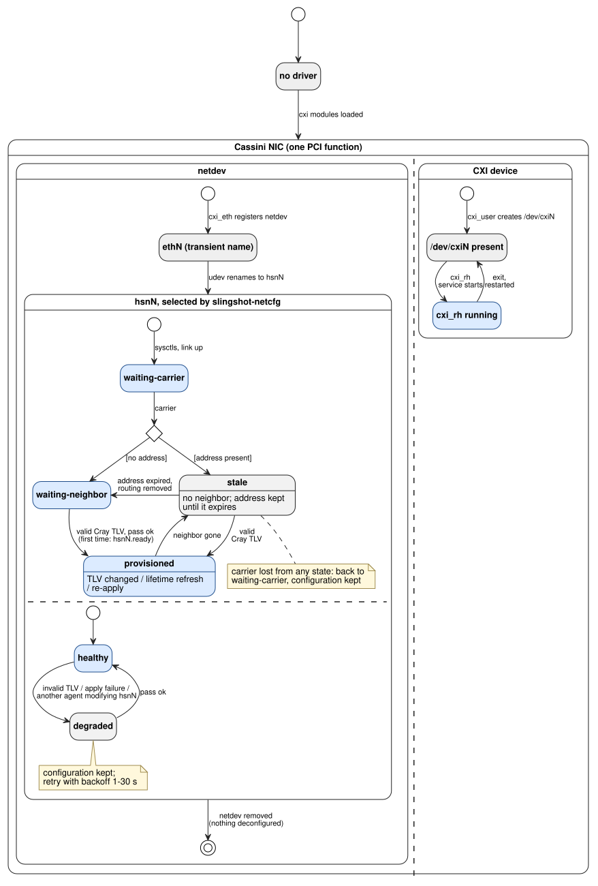

# slingshot-netcfg

Provisions HPE Slingshot (Cassini) HSN interfaces `hsnN` from the Cray LLDP TLV
the Rosetta switch advertises, read through lldpd: fabric MAC, IPv4 address and
lifetime, MTU, per-interface sysctls and source-based policy routing. It runs as
a level-triggered reconciler and replaces HPE's `slingshot-network-config`.

Platforms: Talos Linux (system extension), RHEL 10 and openSUSE Leap 16 (RPM);
amd64 and arm64. Linux only.

## Build

```sh
make binaries        # static binaries in dist/ (CGO_ENABLED=0, -trimpath)
make test            # unit tests (Linux)
make lint
scripts/integration-test.sh   # netns integration tests in a privileged Docker container
```

Packaging: `packaging/rpm/slingshot-netcfg.spec` and the unit in
`packaging/files/`. The Talos extension lives in `slingshot-talos`.

## Run

```
slingshot-netcfg run    [--config PATH] [--lldpcli PATH] [--lldpd-socket PATH] [--iface NAME]...
                        [--dry-run] [--once] [--once-timeout DURATION] [--log-level LEVEL]
slingshot-netcfg decode FILE    # target per interface from saved `lldpcli -f json0 show neighbors details`
```

Requirements: lldpd with custom-TLV support handling `hsn*`, and the matching
`lldpcli`. The config file (`/etc/slingshot-netcfg/config.toml`, TOML) is
optional; every key has a default.

Output in `/run/slingshot-netcfg/`:
- `state.json`: phase, neighbor, target and applied configuration per interface;
- `hsnN.ready`: written once `hsnN` is first provisioned in this boot; use it for
  path-based start dependencies.

Stopping or simply restarting the service never deconfigures anything.

## Bring-up


